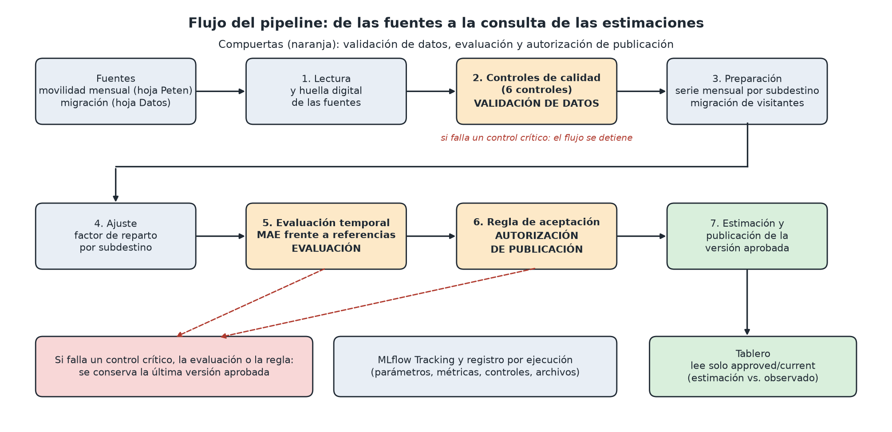

Universidad del Valle de Guatemala
Facultad de Ingeniería — Departamento de Ciencias de la Computación
CC3066 Data Science — Semestre II, 2026

# Laboratorio 11: MLOps — Avance (alcance y diagrama del flujo)

Integrantes: Diego José López Campos (23242), Luis González (23353), Diego Rosales (23258)
Destino asignado: Tikal y Flores (Petén), grupo 3
Fecha: 29 de octubre de 2026

## 1. Qué estima el flujo

| Aspecto | Definición |
|---|---|
| Variable | Visitantes únicos del mes que declara la fuente de movilidad por telefonía móvil |
| Unidad | Personas |
| Nivel de agregación | Subdestino por mes. Tres series: Isla De Flores, El Remate Y Alrededores Lago y Mundo Maya Aeropuerto |
| Segmento | Visitantes extranjeros (todos los países excepto Guatemala). Ver la decisión D1 |
| Meses que se estiman | Enero y febrero de 2026, sin cobertura de telefonía |
| Total de Petén | No se construye. Ver la sección 6 |

## 2. Fuentes y columnas

| Fuente | Archivo y hoja | Columnas usadas |
|---|---|---|
| Movilidad mensual | `BD_moviidad_mensual.xlsx`, hoja `Peten` | `destino`, `sub_grupo`, `anio`, `mes`, `pais`, `es_consecutivo`, `fecha`, `visitantes`, `dias_persona`, `permanencia_prom` |
| Migración | `Base_Migracion_2009-2026jun.xlsx`, hoja `Datos` | `Año`, `Mes cod`, `Tipo de Viajero` (solo Turista y Excursionista), `Viajero` |

Cada ejecución registra la huella SHA-256 de ambos archivos. La base diaria de movilidad no se usa para construir la serie mensual y no se proyecta. `BD_COMPLEMENTARIA` queda fuera del alcance de este laboratorio.

Hechos verificados en los archivos:

- La hoja `Peten` tiene 3,473 filas, tres subdestinos y diez meses: septiembre a diciembre de 2025 y marzo a agosto de 2026. No existen enero ni febrero de 2026.
- La clave `destino + fecha + pais + es_consecutivo` no tiene duplicados.
- Ocho filas tienen `visitantes = 0`, todas del segmento «menor a 1 día» y con `permanencia_prom` vacía. Otras ocho filas, distintas de las anteriores, tienen `pais` vacío.
- El 8.6 % de las filas de `visitantes` tiene decimales, porque las cifras expandidas no son conteos enteros.
- Guatemala es por mucho el primer país de la hoja (2.9 millones en la suma de filas, frente a 57 mil de Estados Unidos, el segundo).
- La migración tiene 161,036 filas y 210 meses consecutivos, de enero de 2009 a junio de 2026. Hay una ruptura metodológica entre 2022 y 2023, que no afecta a este flujo porque solo usa meses de 2025 y 2026.

## 3. Períodos

| Uso | Períodos |
|---|---|
| Meses observados de movilidad | 2025-09 a 2025-12 y 2026-03 a 2026-08 |
| Meses a estimar | 2026-01 y 2026-02 |
| Meses evaluados | 2025-12 y 2026-03 a 2026-06 |
| Ajuste de cada mes evaluado | Todos los meses observados anteriores a ese mes, con un mínimo de 3 |

El factor de cada mes evaluado se calcula únicamente con meses observados anteriores, de modo que no se usa información futura. Julio y agosto de 2026 no se pueden evaluar porque la migración llega solo hasta junio de 2026. Octubre y noviembre de 2025 no se evalúan porque tendrían menos de tres meses de ajuste. No se calcula error para enero y febrero de 2026, porque no hay valores observados con los que compararlos.

## 4. Parámetros y supuestos

Factor de reparto del subdestino `s`, calculado con los meses de ajuste `T`:

```
f_s = suma(V[s,t] para t en T) / suma(M[t] para t en T)
```

Estimación del mes `t`:

```
V_estimado[s,t] = f_s * M[t]
```

`V` son los visitantes extranjeros de la hoja de movilidad y `M` las entradas de Turista más Excursionista de la migración. La migración aporta la forma estacional y el factor aporta la asignación a cada subdestino. Referencias de comparación: último valor observado y promedio de los meses observados anteriores.

Parámetros en `config.yaml`: semilla 42, `factor_method = ratio_of_sums`, mínimo de entrenamiento 3 meses, cobertura esperada de cada fuente y umbrales de aceptación. Los umbrales de aceptación se fijan antes de ver los resultados.

Supuestos:

- El factor se mantiene estable entre meses. Con tres a nueve meses de ajuste, el efecto estacional propio del destino (por ejemplo, Semana Santa) no queda capturado. La validación mide cuánto error produce este supuesto.
- La migración cuenta entradas al país y la movilidad cuenta visitantes únicos del mes. Son medidas distintas y el factor las relaciona de forma implícita.
- No se compara un mes de 2025 con el mismo mes de 2026, porque la fuente no repite ningún mes entre ambos años.

## 5. Archivo que consume el tablero

Cada versión aprobada vive en `approved/<run_id>/` con dos archivos: `estimates.csv` y `meta.json` (métricas, resultados de los controles, parámetros del modelo, huella de las fuentes y commit). El archivo de texto `approved/current` contiene el identificador de la versión vigente, y el tablero lee primero ese puntero y luego los archivos de esa versión.

Una versión se crea completa en una carpeta temporal y solo después se mueve el puntero, de modo que una falla a medias nunca deja al tablero con una versión incompleta. Las versiones anteriores no se borran, y `python -m pipeline.publish.restore --to <run_id>` devuelve el puntero a cualquiera de ellas. Las columnas `run_id`, `generated_at` y `procedure_version` las fija la publicación en el momento de aprobar.

| Columna | Contenido |
|---|---|
| `target` | Destino |
| `subdestination` | Subdestino |
| `period` | Mes (AAAA-MM) |
| `value` | Visitantes. Vacío si no hay dato; nunca cero |
| `unit` | Unidad de medida |
| `kind` | `observed` o `estimated` |
| `run_id` | Identificador de la ejecución |
| `generated_at` | Fecha de generación |
| `procedure_version` | Versión del procedimiento |

## 6. Decisiones y limitaciones

- **D1. Solo visitantes extranjeros.** La migración cuenta entradas internacionales y la hoja `Peten` está dominada por visitantes guatemaltecos, que además traen factor de expansión. Aplicar un factor sobre la migración a esa mezcla no sería consistente. Los visitantes guatemaltecos se reportan aparte y no se estiman con este procedimiento. Se puede revertir dejando vacía la lista `exclude_countries` en `config.yaml`.
- **D2. Sin total de Petén.** La guía de datos prohíbe sumar subdestinos, porque una misma persona aparece en varios. El total no viene en los archivos, así que las tres series se estiman y se presentan por separado.
- **D3. Pocos meses para validar.** Hay cinco meses evaluables. Una métrica calculada con tan pocos puntos es poco robusta, y el informe debe presentarla con esa advertencia.
- **D4. Factor.** Se usa la razón de sumas. Queda abierto compararla con la media de razones mensuales.

## 7. Diagrama del flujo



| Compuerta | Dónde | Qué decide |
|---|---|---|
| Validación de datos | Paso 2 | Detiene el flujo si falla un control crítico |
| Evaluación | Paso 5 | Calcula el error contra las referencias, solo con información anterior a cada mes |
| Autorización de publicación | Paso 6 | Aplica la regla de aceptación y decide si la versión reemplaza a la vigente |

Si cualquiera de las tres falla, no se modifica `approved/current` y el tablero sigue mostrando la última versión aprobada. Si todavía no existe ninguna, el tablero indica que las estimaciones no están disponibles.

## 8. Controles de calidad

| Control | Qué verifica | Advertencia | Detiene |
|---|---|---|---|
| a) Columnas y tipos | Las columnas de la sección 2 y sus tipos | Falta una columna no indispensable | Falta una columna indispensable o su tipo no es compatible |
| b) Fechas y cobertura | `fecha` coherente con `anio` y `mes`; meses observados contra los esperados en la configuración | Enero y febrero de 2026 ausentes (esperado; no se rellenan) | Fecha inválida, o falta un mes que debía tener cobertura |
| c) Unicidad | Clave `destino + fecha + pais + es_consecutivo` | Ninguna | Hay duplicados |
| d) Valores faltantes | `pais` y `permanencia_prom` vacíos frente a `visitantes` | Faltantes permitidos por debajo del umbral | Faltan `visitantes` o la migración del mes a estimar |
| e) Valores y denominadores | `visitantes` menor que cero o no finito; migración del mes igual a cero | Filas con `visitantes = 0` aisladas | Valor negativo o no finito, o migración igual a cero en un mes usado |
| f) Regla metodológica | La serie mensual sale de la hoja mensual y no de la diaria; no existe una fila que sume subdestinos; la estadía se calcula como días persona entre visitantes y no se promedia `permanencia_prom` | Ninguna | Se viola cualquiera de las tres |

Los períodos sin cobertura no se convierten en cero en ningún control.
